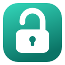

<p align="center"></p>

<h1 align="center">풀림</h1>
<p align="center">자바스크립트로 <b>우클릭 · 글자 선택(드래그) · 복사</b>를 막아 둔 사이트를 다시 쓸 수 있게 풀어 주는 확장 프로그램<br>크롬 · 엣지 · 네이버 웨일 · 자동 업데이트</p>

<p align="center"><a href="https://github.com/omokdie/pullim/releases/latest/download/Pullim-Setup.exe"><b>⬇ 풀림 설치 프로그램 받기 (Windows)</b></a> · <a href="https://github.com/omokdie/pullim/releases/latest">릴리스 · 바뀐 점</a></p>

---

## 설치

1. 위 **풀림 설치 프로그램 받기**를 눌러 `Pullim-Setup.exe` 를 받아 실행합니다.
   "Windows의 PC 보호" 창이 뜨면 **추가 정보 → 실행** (개인이 만든 프로그램이라 코드 서명이 없어서 뜨는 창이에요). 관리자 권한은 필요 없어요.
2. 설치가 끝나면 **설치 안내** 페이지가 열려요. 쓰는 브라우저마다 한 번씩:

   | 브라우저 | 주소창에 입력 | 그다음 |
   |---|---|---|
   | 크롬 | `chrome://extensions` | 오른쪽 위 **개발자 모드** 켜기 → **압축 해제된 항목 로드** |
   | 엣지 | `edge://extensions` | **개발자 모드** 켜기 → **압축을 푼 항목 로드** (Load unpacked) |
   | 웨일 | `whale://extensions` | 아래쪽 **개발자 모드** 켜기 → **압축해제된 확장 앱 설치** |

   폴더 선택 창 주소 칸에 `%LOCALAPPDATA%\Pullim\extension` 을 붙여넣고 Enter → **폴더 선택**.
3. "풀림이 켜졌어요" 탭이 열리면 끝. 이후 업데이트는 알아서 됩니다.

> 크롬은 **개발자 모드를 켜 둔 동안에만** 이렇게 불러온 확장 프로그램을 실행해요(크롬 134부터 규칙).
> 엣지는 시작할 때마다 "개발자 모드 확장을 끄라"는 알림을 띄우는데, 오른쪽 위 **X** 로 닫으면 돼요(**끄기**를 누르면 풀림이 꺼짐).
> 스토어를 거치지 않은 확장 프로그램은 이 방법으로만 설치할 수 있어요.

## 무엇을 풀어 주나요

- **우클릭 메뉴** — `oncontextmenu="return false"`, 우클릭 경고창
- **글자 선택(드래그)** — `onselectstart`, CSS `user-select: none`(인라인 `!important` 까지)
- **복사 · 잘라내기** — `oncopy` 막기, 복사할 때 덧붙는 "출처 · 무단전재 금지" 글(고른 글자만 복사됨)
- **단축키** — Ctrl+C · Ctrl+A · Ctrl+X 막기
- **끌기** — 글자 · 그림을 끌어 옮기기 막기
- 다른 주소에서 온 프레임(네이버 블로그 · 카페처럼 본문이 프레임 안에 있는 페이지), `srcdoc` · `document.write` 로 만든 프레임 안까지

**강력 모드**(아이콘 → 강력 모드) — 일반 모드로 안 풀리는 사이트용
- 마우스를 누르는 순간을 막아 선택이 시작조차 안 되는 페이지
- 고른 글자를 곧바로 지워 버리는 페이지
- 그림 · 글 위에 투명한 판을 덮어 둔 페이지 (우클릭이 아래 그림에 닿게)
- 고른 부분이 안 보이게 해 둔 페이지

일반 모드로 다 안 풀리는 것 같으면 아이콘에 **!** 가 떠서 강력 모드를 권해요.

## 쓰는 법

- 그냥 쓰면 돼요. 모든 사이트에서 켜져 있어요.
- 아이콘 글자: 없음 = 켜짐 · **끔** = 이 사이트에서 꺼 둠 · **강** = 강력 모드 · **!** = 강력 모드가 필요해 보임
- 사이트 기능이 이상해지면 아이콘 → **이 사이트** 스위치 끄기
- 사이트 자체 우클릭 메뉴가 필요하면 **Shift + 우클릭**
- 구글 문서 · 드라이브 · 지메일 · 지도 · 유튜브 · 피그마 · 노션 · 오피스 · 디스코드 · 네이버 지도 등 자체 메뉴를 쓰는 웹 앱은 처음부터 꺼 뒀어요(설정에서 켤 수 있음).
- 입력 칸 · 글쓰기 편집기 안에서는 사이트가 하는 대로 둬요(비밀번호 관리자 · 편집기 복사 기능이 망가지지 않게).

## 자동 업데이트

```
GitHub 릴리스 ──(3시간마다 · 로그인할 때)──▶ 풀림 업데이트 도우미 (PullimHelper.exe, 창 없음)
  latest.json        새 버전이면 받아서 SHA-256 · 크기 확인 → %LOCALAPPDATA%\Pullim\extension 파일 바꿈
                                                     │
크롬 · 엣지 · 웨일 속 풀림 ◀──(10분 안에 알아채고 스스로 다시 불러옴)──┘
```

- 바로 확인: 시작 메뉴 → 풀림 → **풀림 업데이트 확인**
- 기록: `%LOCALAPPDATA%\Pullim\helper.log`
- 풀림이 인터넷에 접속하는 건 GitHub 에서 업데이트 정보를 읽을 때뿐이에요. 아무것도 보내지 않아요.

## 지우기

설정 → 앱 → 설치된 앱 → **풀림 - 우클릭·드래그·복사 제한 해제** 제거, 그리고 각 브라우저의 확장 프로그램 페이지에서 풀림 **삭제**.

## 자주 묻는 것

- **강력 모드로도 안 풀려요** — 글자를 그림 · 캔버스로 그린 페이지, 글자를 뒤섞은 글꼴로 보여 주는 페이지는 확장 프로그램으로 풀 수 없어요.
- **설치 프로그램 없이 쓰고 싶어요** — 릴리스의 `pullim-extension.zip` 을 풀어 그 폴더를 불러오면 돼요(자동 업데이트는 안 됨).
- 복사한 글과 그림의 저작권은 원래 만든 사람에게 있어요. 퍼 갈 때는 출처를 밝히고 허락된 범위에서 써 주세요.

---

개발 · 새 버전 내보내기: [RELEASING.md](RELEASING.md)
